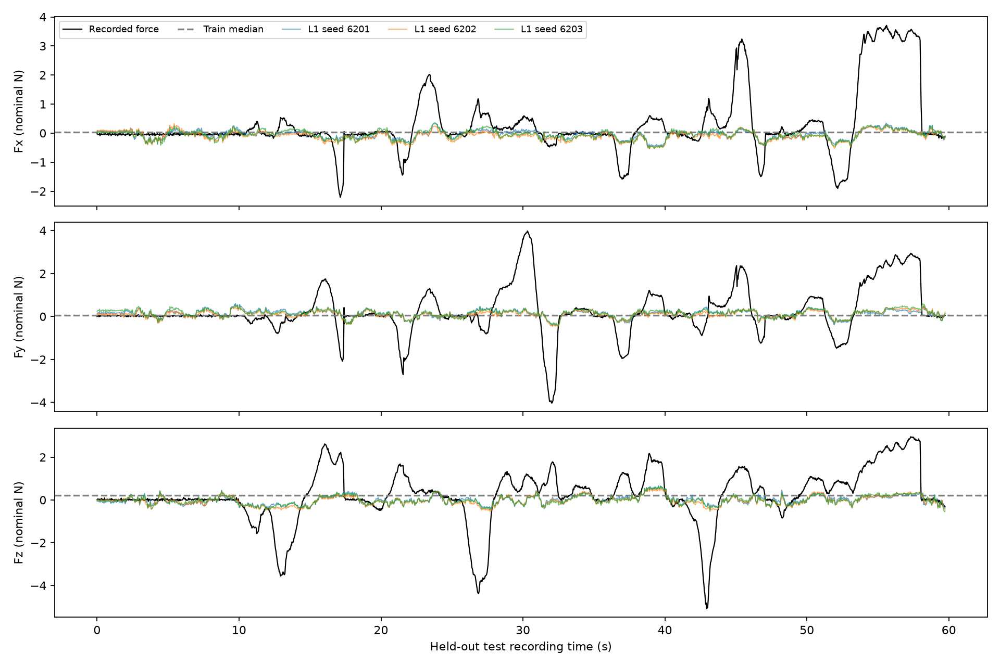

# Vision-Based Force Estimation for Robotic Tissue Manipulation

An exploratory computer vision project combining synthetic robustness experiments with three-axis force regression from robotic tissue-manipulation images. Developed with AI-assisted coding and experiment analysis.

**Status:** research prototype. The fixed visual model modestly outperformed a constant baseline on one held-out material recording, but substantially underestimated force peaks. This is not a validated force-feedback or clinical system.

## What was investigated

- Synthetic HSV segmentation, row-occupancy height measurement, and rotation-aware minimum-area rectangles under fixed simulated compression.
- ROS bag extraction and nearest-recording-time pairing of RGB images with raw Fx/Fy/Fz sensor measurements.
- Train-mean and train-median baselines, a small CNN, frozen ImageNet ResNet18 features with ridge regression, and a linear prediction head trained with L1/MAE loss.
- Recording-level splits, train-only normalization, three-seed experiments, frozen held-out evaluation, and distribution-shift diagnosis.

The synthetic spring model F=kx is a controlled simulation. It is not the labeling method for the real-image regression experiments.

## Pilot dataset

Four recordings from the authors' [realistic tissue-manipulation dataset](https://zenodo.org/records/21041361), described in the [upstream project](https://github.com/enhanced-telerobotics/Telesurgical-Tool-Vision-based-Contact-Detection).

| Split | Recordings | Frames |
|---|---|---:|
| Training | M1_L_V1_1, M3_L_V1_1 | 3,473 |
| Validation | M1_L_V1_2 | 1,742 |
| Held-out test | M2_L_V1_1 | 1,733 |

These are 6,948 correlated video frames, **not 6,948 independent trials**. Validation shares material M1 with training; the test uses unseen material M2 at the same arm/view. This is a small pilot, not the complete official benchmark.

Raw bags, images, extracted feature arrays, model checkpoints, credentials and server details are excluded. Download source data separately and comply with its terms. No third-party dataset redistribution rights are granted by this repository.

## Recorded results

Validation checkpoints were selected using validation macro MAE (mean absolute error averaged over frames and three axes).

| Method | Validation macro MAE (nominal N) |
|---|---:|
| Train mean | 0.2833 |
| Train median | 0.2576 |
| Small CNN, three seeds | 0.2712 ± 0.0067 |
| Frozen ResNet18 + ridge | 0.2663 |
| Frozen ResNet18 + L1 linear head, three seeds | 0.2411 ± 0.0036 |

The CNN row summarizes three runs; `cnn_validation_metrics.json` preserves the first run. Full three-seed values and chronology are documented in `RESULTS_ZH.md`.

The L1 heads were then fixed, without test-based model selection:

| Method | Test macro MAE (nominal N) |
|---|---:|
| Train mean | 0.7117 |
| Train median | 0.6924 |
| L1 head, seed 6201 | 0.6743 |
| L1 head, seed 6202 | 0.6729 |
| L1 head, seed 6203 | 0.6733 |
| L1 heads, mean ± sample SD | **0.6735 ± 0.0007** |

The 2.7% improvement over the median baseline is small and does not establish reliable dynamic force reconstruction. Seed variability is not a confidence interval across materials. Absolute test error is much larger than validation error. Repeated development on one validation recording also creates selection bias.



## Reproduce the workflow

Use Python 3.12. The recorded experiments used a Linux CPU environment with four PyTorch threads. Package versions are the recorded direct dependencies, not a guarantee of bitwise reproducibility across platforms. No GPU is required.

```bash
python -m venv .venv
source .venv/bin/activate
python -m pip install -r requirements.txt
```

### Synthetic experiment (no external data)

```bash
python synthetic_rotation.py
```

The script generates its own rectangular reference image and writes timestamped plots and measurements.

### Prepare and audit data

```bash
python day5_prepare_splits.py
python day5_audit_splits.py
```

Preparation downloads four pinned source bags (about 1.2 GB in total), verifies checksums, exports original JPEG payloads, and produces `day5_prepared_<timestamp>`. Keep at least 4 GiB free. Set `DATA` to the exact completed output directory:

```bash
DATA="/absolute/path/to/day5_prepared_TIMESTAMP"
python day6_train.py --data "$DATA" --epochs 10 --seed 6001
python day6_train.py --data "$DATA" --epochs 10 --seed 6002
python day6_train.py --data "$DATA" --epochs 10 --seed 6003
python day6_transfer.py --data "$DATA"
```

ResNet18 weights download from the official PyTorch host on first use. The feature experiment uses `ResNet18_Weights.IMAGENET1K_V1.transforms()` and selects ridge alpha from the fixed grid 1, 10, 100, 1000, 10000. Use its printed output directory as `FEATURES`:

```bash
FEATURES="/absolute/path/to/day6_transfer_TIMESTAMP"
python day6_l1_head.py --data "$DATA" --features "$FEATURES"
```

The L1 script runs seeds 6201–6203, each for 100 epochs with Adam, learning rate 0.001, weight decay 0.01 and batch size 128. It initializes from the training median and includes the constant epoch-0 checkpoint when selecting by validation MAE. In the recorded experiment, all selected checkpoints were epoch 1. This selection rule alone cannot demonstrate a visual advantage.

For a genuinely new experiment, freeze the checkpoints and protocol **before** accessing a held-out test. To reproduce the historical evaluation:

```bash
HEADS="/absolute/path/to/day6_l1_TIMESTAMP"
python day6_test.py --data "$DATA" --heads "$HEADS"
```

`TEST_PROTOCOL.md` documents the original frozen evaluation. Re-running this script is reproduction, not a new independent confirmation. No model training takes place in the evaluation script.

## Limitations and next steps

- Image and force header timestamps were invalid; pairing uses bag recording timestamps. Small pairing gaps do not validate acquisition synchronization or latency.
- Force frame IDs were empty. The physical coordinate mapping and sensor zero were not verified; Fz must not be called tissue-normal force without calibration.
- The test recording has a different force distribution: 33.6% of test frames exceed the training 90th-percentile force-distance threshold versus 7.5% in validation. This is descriptive, not proof of a causal explanation.
- There is one held-out recording and substantial peak underestimation. No clinical, deployment, real-time, or safety performance is claimed.
- Subsequent tuning needs additional development recordings and a new untouched test set; the original M2 test has now been evaluated and inspected.

## Files and provenance

- `day5_*.py`: source preparation and integrity audit.
- `day6_*.py`: CNN, frozen-feature regression, L1 heads and fixed evaluation.
- `*_metrics.json`: recorded numerical evidence; sanitized local paths.
- `RESULTS_ZH.md`: Chinese experiment conclusions, including the chronological correction after adding the median baseline.
- `gitignore-template.txt`: copy to `.gitignore` if your download client omits hidden files.

The scripts were adapted from the original dated experiment workspace to accept explicit data/feature/checkpoint paths. Historical outputs are retained separately; no original experiment data were overwritten.

## References

Yang et al. (2024), *Vision-Based Force Estimation for Minimally Invasive Telesurgery Through Contact Detection and Local Stiffness Models*, Journal of Medical Robotics Research. [DOI](https://doi.org/10.1142/S2424905X24400087).

[Dataset](https://zenodo.org/records/21041361) · [Author repository](https://github.com/enhanced-telerobotics/Telesurgical-Tool-Vision-based-Contact-Detection) · [Torchvision ResNet18](https://docs.pytorch.org/vision/stable/models/generated/torchvision.models.resnet18.html)

No software license has been selected for this initial review version. Third-party code, data and pretrained weights remain subject to their respective terms.
